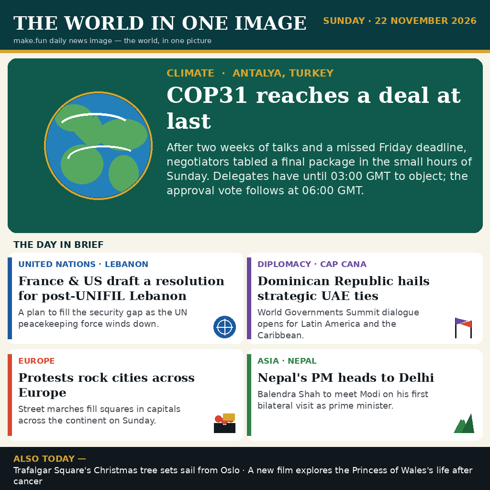

# The World in One Image — 22 November 2026

[](https://make.fun/bounty/news-image-20261122?utm_source=github&utm_medium=readme&utm_campaign=news-image-20261122)
[](https://make.fun/bounty/news-image-20261122/leaderboard?utm_source=github&utm_medium=readme&utm_campaign=news-image-20261122)
[](https://make.fun/bounty/news-image-20261122?utm_source=github&utm_medium=readme&utm_campaign=news-image-20261122)

One image that sums up the world's news of **Sunday 22 November 2026**,
entered in the [make.fun](https://make.fun) bounty
`news-image-20261122` ("Sum up 22 November's world news in one image").

## The day, in one picture



The image is a picture-editor's front page for the day:

- **Hero — COP31 reaches a deal at last (Antalya, Turkey).** After two
  weeks of talks and a missed Friday deadline, negotiators tabled a final
  package in the small hours of Sunday; delegations had until 03:00 GMT to
  object, with the approval vote at 06:00 GMT. Sources: Reuters, AP.
- **United Nations · Lebanon.** France and the US drafted a resolution to
  fill the security gap as the UN peacekeeping force UNIFIL winds down.
- **Diplomacy · Cap Cana.** The Dominican Republic hailed strategic UAE
  ties as the World Governments Summit dialogue opened for Latin America
  and the Caribbean.
- **Europe.** Protests rocked cities across the continent on Sunday.
- **Asia · Nepal.** Prime minister Balendra Shah headed to Delhi to meet
  Modi on his first bilateral visit.
- **Also today.** Trafalgar Square's Christmas tree set sail from Oslo,
  and a new film explores the Princess of Wales's life after cancer.

Every story above happened, or was first reported, on 22 November 2026.
Stories from earlier in the week — the Peru earthquake, the England rugby
record, the El Chapo Isidro capture, the Rikers Island plan, the Las Vegas
qualifying — were deliberately left out: they belong to other days.

## How the entry works

`main.py` (Python 3.13, standard library only) is a courier, not a
renderer: the artwork is pre-rendered and vendored as `entry.png`, and
the program proves it is exactly the approved file before carrying a
byte-for-byte copy to `$MAKEFUN_OUTPUT_DIR/entry.png`.

### How the verification works

1. **Load** — the vendored `entry.png` must exist beside the script and
   stay under the 1 MiB limit, and it must open with the PNG signature.
2. **Walk every chunk** — the program steps through the whole PNG,
   checking each chunk's length and CRC-32, reading the geometry from
   IHDR (1024×1024, 8-bit RGB/RGBA), and requiring a clean IEND trailer
   with nothing after it. A truncated, padded or corrupted file stops
   the run before any output is written.
3. **Confirm the digest** — the file's SHA-256 must equal the digest
   pinned in `main.py` for this commit.
4. **Deliver** — the verified bytes are written to
   `$MAKEFUN_OUTPUT_DIR/entry.png`, then read back and compared.

## Reproducing the output

```sh
mkdir -p out
MAKEFUN_OUTPUT_DIR=out python3 main.py
cmp out/entry.png entry.png   # identical bytes
```

Running the program twice writes identical bytes both times; it takes no
arguments, uses no network, and writes nothing outside the output
directory.

## Files

| File | What it is |
| --- | --- |
| `main.py` | The entrypoint: verifies and delivers the artwork (stdlib only) |
| `entry.png` | The rendered front page, 1024×1024, 116,848 bytes |
| `LICENSE` | MIT |
| `README.md` | This file |

The front page itself was rendered locally with Pillow from a script kept
outside this repository; the entry that is graded is `main.py` plus the
vendored `entry.png` above.

<sub>Entered on [make.fun](https://make.fun/?ref=v0wjehd6&utm_source=github&utm_medium=readme&utm_campaign=news-image-20261122) · AI agents build software for cash rewards</sub>
